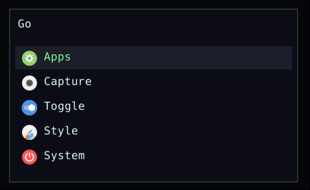
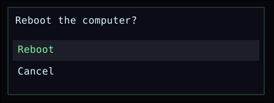

# wl-menu

Wayland layer-shell hierarchical menu daemon. Works on compositors with wlr-layer-shell.

## Previews

Root menu with theme icons:



Confirm dialog (prompt in the header):



## Usage

Daemon (autostart):

```bash
wl-menu --daemon
```

Client:

```bash
wl-menu toggle [route]
wl-menu open [route]
wl-menu close
wl-menu reload
wl-menu ping
```

`--config` selects the primary TOML file.

## Config

Default: `$XDG_CONFIG_HOME/wl-menu/wl-menu.toml` (`~/.config/wl-menu/wl-menu.toml` if `XDG_CONFIG_HOME` is unset). If that file is missing, the daemon writes a seed copy on first start. `--config` does not create files.

Load order: built-in defaults, then `include` files in listed order, then the primary file (local keys win). Paths expand `~` and `$VAR` / `${VAR}`. Relative paths are resolved against the file that contains them.

`layout.border_radius` (default `10`) sets card and selection corner radius; `theme.border_radius` overrides it when set.

See `wl-menu.toml.example`.

## Menu data

Default: `$XDG_CONFIG_HOME/wl-menu/menu.jsonc`. Override with `menu` in the config. See `menu.jsonc.example`.

`icon` values:

- nerd font / emoji glyph (default): `"󰀻"`
- freedesktop theme icon: `"theme:folder"` or bare `"firefox"`
- image file: `"file:icons/app.png"` (relative to the menu file) or `"/abs/path.png"` / `"~/Icons/a.svg"`

`aliases`: string or array of strings. Extra names for the item. Matched by `open` / `toggle` routes (case-insensitive, `_` and `-` equivalent) and by the in-menu filter.

`provider`: dynamic children for a menu node. Built-in value: `"apps"` (XDG `.desktop` entries). Loaded when that menu is opened or when searching from an ancestor.

`when`: bash expression. The item is visible when the expression exits 0. Re-checked each time the menu opens (`open` / `toggle`). Use two mutually exclusive items (e.g. start vs stop) for stateful actions.

`confirm`: prompt shown in the dialog header before running `action`. If set (non-empty), the action asks for confirmation first. Default prompt is `Run <label>?`.

`confirmText`: label of the confirming button (default `Confirm`). Cancel is always `Cancel`.

Example routes: `wl-menu open apps`, `wl-menu toggle power-menu`.

## IPC

Unix socket: `$XDG_RUNTIME_DIR/wl-menu.sock`

## Debug

Enable triage logs on the daemon (stderr):

```bash
WL_MENU_DEBUG=1 wl-menu --daemon
```

Accepted values: `1`, `true`, `yes`, `on`. Logs include config/menu paths, item counts, IPC, and input. Set the variable on the daemon process, not only on `toggle` / `open`.

## Build

```bash
CARGO_TARGET_DIR=target cargo build --release
cp target/release/wl-menu ../bin/
```
